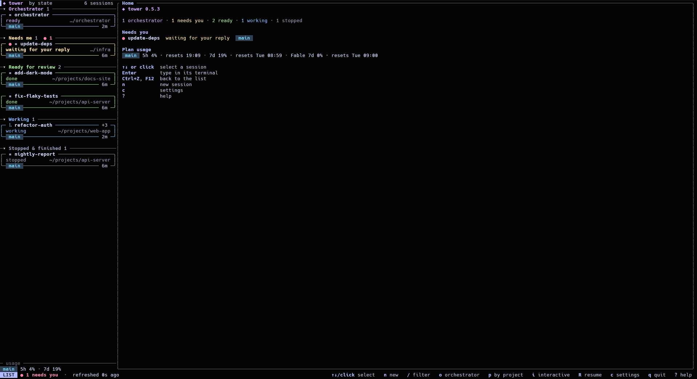
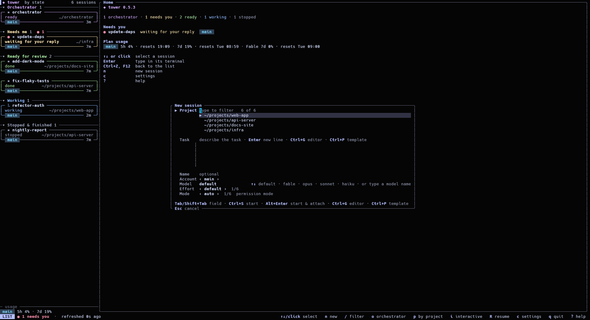

# Watchtower

[](https://github.com/ruslan1us/watchtower/actions/workflows/ci.yml)
[](https://github.com/ruslan1us/watchtower/releases/latest)
[](LICENSE)

When you run many Claude Code sessions at once, it gets hard to see which one is done, which one is stuck and which one is waiting for you. Watchtower (`tower`) shows them all on one screen.

Tower is a list on top of Claude Code's own background sessions. It starts, opens, stops and removes them with Claude Code's own commands. The sessions don't depend on tower, so they keep running if tower closes or your connection drops.


## Features

- [All sessions by state](doc/guide/how-it-works.md#what-tower-adds): see what needs you, what failed, what is ready for review and what is still working.
- [A session's real terminal inside tower](doc/guide/workspace-style.md): the workspace style shown above. It is experimental, and the welcome window offers it first.
- [Several accounts](doc/guide/configuration.md#accounts): every Claude Code account you use, in one list.
- [Hand-off](doc/guide/accounts-and-terms.md): continue a session under another of your own accounts, with its history.
- [Quick reply](doc/guide/sessions.md#quick-reply): send a session your next prompt without opening it.
- [Prompt templates](doc/guide/sessions.md#prompt-templates): keep the texts you type often in files, and insert them with a key.
- [Slash-command suggestions](doc/guide/sessions.md#slash-commands): type `/` to see your skills and custom commands.
- [Orchestrator](doc/guide/orchestrator.md#the-orchestrator): a session you can ask what your other sessions are doing.
- [Plan usage](doc/guide/plan-usage.md): see the usage numbers Claude Code reports for each account. It is off by default.
- [Pinning](doc/guide/sessions.md#pinning-a-session): keep a session at the top of the list.
- [Restart after an update](doc/guide/sessions.md#restarting-after-an-update): move running sessions onto the Claude Code you just installed.
- [Themes](doc/guide/configuration.md#themes): colours for dark and light terminals.





## Requirements

- Linux x86_64.
- Claude Code 2.1.300 or newer.
- `curl`, only for `tower update`.
- Rust 1.88 or newer, only to build from source.

## Install

```sh
mkdir -p ~/.local/bin && curl -Lo ~/.local/bin/tower https://github.com/ruslan1us/watchtower/releases/latest/download/tower-x86_64-linux-musl && chmod +x ~/.local/bin/tower
```

To update later, run `tower update`.

To check the download against its checksum, or to build from source, see [Getting started](doc/guide/getting-started.md).

## Quick start

1. Run `tower`. The first time, a welcome window asks for a style, a theme and your project folders. `tower setup` opens it again later.
2. Your background sessions appear in the list. Press `n`, pick a project, type a task and press `Ctrl+S` to start it.
3. Press `Enter` on a session to open it. `Ctrl+Z` brings you back to tower.
4. Press `?` to see all keys, and `q` to quit.

## Documentation

| Page | What it covers |
|---|---|
| [Getting started](doc/guide/getting-started.md) | Requirements, all install options, updating, building from source, the full quick start |
| [Keys](doc/guide/keys.md) | Every key, window by window |
| [Configuration](doc/guide/configuration.md) | The welcome window, the config file, the Settings window, accounts, styles, themes |
| [Workspace style](doc/guide/workspace-style.md) | Claude Code's real terminal beside the list |
| [Working with sessions](doc/guide/sessions.md) | Quick reply, prompt templates, slash commands, pinning, restarting after an update |
| [The orchestrator and the `tower` commands](doc/guide/orchestrator.md) | The orchestrator, `tower status`, `tower dispatch` and `tower wake` |
| [Plan usage](doc/guide/plan-usage.md) | The optional usage display |
| [Accounts and terms](doc/guide/accounts-and-terms.md) | Using several accounts, hand-off, safety notes |
| [How it works](doc/guide/how-it-works.md) | What tower adds and does not do, where its files live, known limitations |
| [Development](doc/guide/development.md) | Checks, tests and releases |
| [Design decisions](doc/README.md) | Why tower works the way it does |
| [Claude Code CLI reference](doc/reference/claude-code-cli.md) | The Claude Code behaviour tower relies on |

## Accounts and terms

Use your own accounts. Don't move sessions between an employer-provided account and a personal one without your organisation's permission. The full note is in [Accounts and terms](doc/guide/accounts-and-terms.md).

Watchtower is an independent project, not affiliated with or endorsed by Anthropic. Claude and Claude Code are trademarks of Anthropic.

## License

MIT, see [LICENSE](LICENSE).
