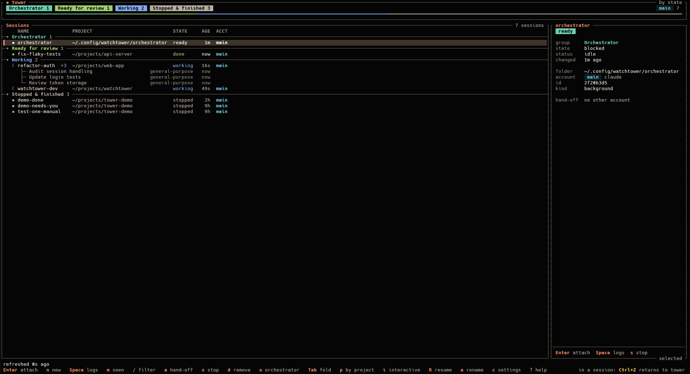

# Watchtower

Watchtower (`tower`) is a terminal UI for keeping track of many parallel Claude Code
background sessions. It is a thin front end over Claude Code's own commands: sessions are
started with `claude --bg`, listed with `claude agents --json --all`, and entered,
inspected, stopped and removed with `claude attach`, `logs`, `stop` and `rm`. Sessions keep
running when tower exits; tower holds nothing they depend on.



What it adds on top:

- **Several accounts in one view.** Every configured Claude Code account (each its own
  `CLAUDE_CONFIG_DIR`) is polled and merged into one list, grouped by state (Orchestrator,
  pinned at the top, then Needs me, Failed, Ready for review, Working, Stopped & finished,
  Interactive) or by project.
- **Hand-off between your own accounts.** `a` stops a session and continues it under another
  of your own accounts with the same history and project context, after asking. By default
  it stays inside the owner's account group ([Accounts and terms](#accounts-and-terms)).
- **An orchestrator session.** `o` opens an ordinary background session named
  `orchestrator` that you can ask what your sessions are doing.
- **Visual-only attention.** A session that starts waiting for you or fails gets a `●`
  marker and bold text until you attach or mark it seen. No bell, sound or desktop
  notifications.
- **Quick reply.** `t` on a session waiting for review sends it a text (typed, or a
  [prompt template](#prompt-templates)) as your next prompt, under its own account and id,
  without attaching ([Quick reply](#quick-reply)).
- A new-session dialog, a logs panel that replays `claude logs`, and a text filter.
- **Subagents under their session.** A working session tower started shows its running
  subagents as a dimmed tree under its row, with a `+N` badge ([0029](doc/0029-tracking-subagents.md)).
- **A dashboard look by default:** count pills per state, the list in panels, and a detail
  panel for the selected session; `[ui] style = "minimal"` gives the plain list
  ([Configuration](#configuration)).

## What it does not do

Tower never runs, supervises or reconfigures agents. It has no PTY handling, no tmux, no
Agent SDK and no direct API calls, and it does not read Claude Code's internal files
([0001](doc/0001-thin-wrapper-over-claude-cli.md)). It never changes Claude
Code's settings, keybindings or defaults ([0016](doc/0016-do-not-change-claude-code-defaults.md)).
The one thing it adds to the sessions it starts is a `--settings` file with three
observe-only hooks that record their running subagents in tower's own files; turn it off
with `[sessions] track_subagents = false` ([0029](doc/0029-tracking-subagents.md)).
It never reads, stores or passes on credentials or session tokens, never runs
`claude setup-token`, never proxies or routes requests, and has no hosted, shared or
multi-user mode: it is a single-user local tool around the unmodified official `claude`
binary. There is no quick reply without attaching, no usage or limit display, no automatic
or limit-based hand-off, no pinning and no chat or diff views. The full list of non-goals
is in [0014](doc/0014-v1-scope.md).

## Accounts and terms

Tower only switches between accounts you already use with Claude Code. This is a short
summary of what that means, not legal advice.

- **Your own accounts, official login.** Every configured account must be your own and
  logged in through the official `claude` CLI
  ([Authentication](https://code.claude.com/docs/en/authentication)). Tower never handles
  credentials.
- **A hand-off moves the whole conversation.** After `a`, the full conversation and project
  context continue under the target account, under that account's terms. Training,
  retention and admin controls differ between consumer (Free, Pro, Max) and commercial
  (Team, Enterprise, API) accounts; see
  [Data usage](https://code.claude.com/docs/en/data-usage).
- **Keep employer and personal accounts apart.** Don't move sessions between an
  employer-provided account and a personal one without your organisation's permission.
  Give each account a `group` (e.g. `work`, `personal`): `a` then offers only accounts in
  the session owner's group, because `allow_cross_group_handoff` is off by default
  ([Configuration](#configuration)).
- **Usage limits.** When an account hits its usage limits, use Anthropic's official
  options: usage credits, upgrading your plan, API usage, or waiting for the reset.
- **Shared history mixes accounts.** Config dirs that share history through symlinks mix
  those accounts' transcripts and memory.
- Claude Code is governed by the terms listed under
  [Legal and compliance](https://code.claude.com/docs/en/legal-and-compliance) and by the
  [Usage Policy](https://www.anthropic.com/legal/aup).

## Requirements

- Linux x86_64 (account detection reads `/proc`).
- Claude Code 2.1.300 or newer, with background sessions and agent view (`claude --bg`,
  `claude agents`); see [doc/reference/claude-code-cli.md](doc/reference/claude-code-cli.md).
- `curl`, only for `tower update`.
- Rust 1.88 or newer (via rustup), only to build from source.

## Build and install

### Install from a release

Each release ships a fully static x86_64 Linux binary that runs whatever the glibc
version ([0012](doc/0012-build-and-distribution.md)):

```sh
mkdir -p ~/.local/bin
curl -Lo ~/.local/bin/tower https://github.com/ruslan1us/watchtower/releases/latest/download/tower-x86_64-linux-musl && chmod +x ~/.local/bin/tower
```

When installing as root you may prefer `/usr/local/bin/tower`.

To check the download against the published checksum, fetch both files under their
release names, verify, then install:

```sh
cd "$(mktemp -d)"
base=https://github.com/ruslan1us/watchtower/releases/latest/download
curl -LO "$base/tower-x86_64-linux-musl" -LO "$base/tower-x86_64-linux-musl.sha256"
sha256sum -c tower-x86_64-linux-musl.sha256 && install -m 755 tower-x86_64-linux-musl ~/.local/bin/tower
```

### Updating

`tower update` (or `tower --update`) replaces the installed binary with the latest
release ([0023](doc/0023-self-update.md)):

```sh
tower update                    # install the latest release
tower update --check            # only report; exit 0 up to date, 10 newer release, 1 error
tower update --version v0.2.1   # install that release (reinstall or downgrade)
```

It finds the latest version from the redirect of the `releases/latest` page, falling back
to the GitHub API (which allows only about 60 requests an hour per address), and
`--version` skips that lookup ([0026](doc/0026-latest-release-from-the-web-redirect.md)).
It downloads the binary and its checksum with the system `curl` into a temp dir next to
the installed file, verifies the SHA-256, checks that the new binary runs and reports the
expected version, and only then swaps it in with one atomic rename, keeping the file's
permissions. On any failure the old binary stays as it was. If the binary's directory is
not yours (e.g. `/usr/local/bin`), run `sudo tower update`. Running tower instances keep
the old version until restarted. This is the only command that uses the network; tower
never checks for updates on its own. A cargo build under `target/` is refused unless you
pass `--force`.

Versions before `update` existed (v0.2.x) need the install command above once, to get
the first release that has it.

### Build from source

`cargo build --release` builds `target/release/tower` for the local machine. For the same
static binary as the releases:

```sh
rustup target add x86_64-unknown-linux-musl
cargo build --release --target x86_64-unknown-linux-musl
install -m 755 target/x86_64-unknown-linux-musl/release/tower ~/.local/bin/
```

For another host, copy that one file into its `~/.local/bin` (e.g. with `scp`).

## Quick start

1. Copy [`config.example.toml`](config.example.toml) to `~/.config/watchtower/config.toml`,
   list your accounts and set `project_roots` to the folders that hold your git clones
   (e.g. `~/workspace`). Without a config file tower uses one account, `main`, running
   `claude`, and the new-session dialog has no projects to offer; tower then says so in
   its status line, and `tower status` and `tower --help` name the config file in use.
2. Run `tower`. Existing background sessions of every account appear in the list.
3. Press `n`, pick a project, type a task and press `Ctrl+S` to start it in the background
   (or `Ctrl+Enter` / `Alt+Enter` to start and attach). If the account does not trust the
   folder yet, `Ctrl+T` opens `claude` there so you can accept, then retries.
4. Press `Enter` on a session to attach. Inside it, `Ctrl+Z` returns to tower.
5. Press `?` for all keys, `q` to quit.

## Configuration

The config is `$XDG_CONFIG_HOME/watchtower/config.toml` (default
`~/.config/watchtower/config.toml`). Every key is optional; see
[`config.example.toml`](config.example.toml) for each key with its default, and
[0002](doc/0002-tech-stack-and-files.md) for the details. The example defines two
accounts: `main` (`claude`, `~/.claude`) and `alt` (`claude-alt`, `~/.claude-alt`).

Press `c` in tower to change settings: the Settings window
([0024](doc/0024-settings-window.md)) edits the style and theme (previewed as you
browse), the new-session defaults, the project folders, the hand-off prompt and guard,
the poll interval, the background logs follow and subagent tracking; `Ctrl+S` saves, `e` opens the file in `$VISUAL` / `$EDITOR`.
Accounts are shown read-only there; edit them in the file and restart tower. The window
saves through [0022](doc/0022-tower-writes-its-own-config.md): it writes only the keys you change
and keeps your comments and formatting; resetting a setting to its default removes the
key (its comment lines stay). Before its first write it copies the file once to
`config.toml.bak`, and a symlinked config is written through to its target. A running
tower reloads `config.toml` when it changes, whoever changed it: everything applies at
once except `[[accounts]]`, which need a restart (the status line says so). A file that
does not parse is not applied; the status line shows the error until it is fixed.

- **Accounts.** Each account has a `name`, the `command` tower runs for it, and its
  `config_dir`. `default_account` is used for new sessions and the orchestrator; the
  new-session dialog lets you pick another one per session.
- **Wrappers.** `command` is run as-is. Tower never sets `CLAUDE_CONFIG_DIR` itself and
  removes an inherited one from every command it runs (and warns when started with one set),
  so a second account needs a wrapper that sets it, e.g. a `claude-alt` script on `PATH`:

  ```sh
  #!/bin/sh
  CLAUDE_CONFIG_DIR="$HOME/.claude-alt" exec claude "$@"
  ```

- **`config_dir`** (default `~/.claude`) is how tower recognises which account hosts a
  running session: it reads `CLAUDE_CONFIG_DIR` from the session process's
  `/proc/<pid>/environ` and compares paths. Every account needs its own `config_dir`;
  two accounts on the same directory are rejected.
- **Shared lists.** Accounts whose config dirs share session storage through symlinks list
  the same sessions. Tower merges them by session id and tracks the owner itself
  ([0003](doc/0003-accounts-and-session-ownership.md)).
- **Groups.** An account may set `group`; accounts without one share one implicit group.
  A hand-off offers only accounts in the same group as the session's owner. The top-level
  `allow_cross_group_handoff` (default `false`) allows hand-offs across groups. While the
  owner is unknown and the accounts span several groups, tower refuses the hand-off until
  the owner is known ([0018](doc/0018-account-groups-and-handoff-guard.md)). With the
  example accounts:

  ```toml
  allow_cross_group_handoff = false

  [[accounts]]
  name = "main"
  command = "claude"
  group = "work"

  [[accounts]]
  name = "alt"
  command = "claude-alt"
  config_dir = "~/.claude-alt"
  group = "personal"
  ```

  Here `a` refuses to move a session from `main` to `alt` and says which groups differ.

- **Styles.** `[ui] style` picks the look of the session list
  ([0020](doc/0020-visual-styles.md)). The default, `"dashboard"`, draws rounded panels:
  a header with a count pill per state and the accounts, the session list with section
  separators, and a detail panel for the selected session (on the right from 130 columns,
  a strip under the list below that; the logs panel takes its place while open). When the
  session's folder is a git work tree, the panel has a `git` line with the branch, the
  number of changed files and the commits not pushed yet, e.g.
  `git  feature/login · 3 changed · ↑2` ([0037](doc/0037-git-summary-and-shell.md)). It needs
  at least 80×24 and uses the plain layout on a smaller terminal. For the plain
  single-column list, switch back to `"minimal"`:

  ```toml
  [ui]
  style = "minimal"
  ```

  Colours follow `NO_COLOR` in both styles.

- **Themes.** `[ui] theme` picks the dashboard's colours
  ([0021](doc/0021-dashboard-themes.md)): `"neutral"` (the default, grey text with colour
  only for states and attention), `"warm"` (warm greys, a clay-orange accent),
  `"terminal"` (your terminal's own named colours, reverse video for the selection and
  pills, so it follows light themes too) or `"tokyo-night"` (the original blue-grey
  palette). The minimal style keeps its own look, and `NO_COLOR` turns colour off under
  every theme.

  ```toml
  [ui]
  theme = "terminal"
  ```

- **Background logs follow.** Tower fetches `claude logs` of every working session, and
  of the session you are attached to, every `logs_follow_secs` seconds (default `10`), so
  the logs panel keeps the whole screen however long a session works
  ([0030](doc/0030-continuous-logs-stream.md)). It may be `5` to `30`: a capture covers
  only about the last 40 seconds of a working session, so a longer interval loses the
  overlap and the screen breaks up again. `0` turns these fetches off; the open logs
  panel still fetches on every poll, and tower still fetches once right after it starts a
  session or an attach returns ([0031](doc/0031-logs-follow-interval.md)).

  ```toml
  logs_follow_secs = 0
  ```

## Prompt templates

Texts you type again and again (review instructions, say) can live as templates: one
file per template in `~/.config/watchtower/templates/` (the `templates` folder next to
your `config.toml`), named `<name>.md`. In the new-session dialog `Ctrl+P` opens a picker
with the names and each template's first line; type to filter, `↑` / `↓` to choose,
`Enter` inserts the text into the task (at the cursor, or as the whole task when it is
empty), `Esc` closes the picker. The [quick reply](#quick-reply) window has the same
picker on `Ctrl+P`.

```text
~/.config/watchtower/templates/
├── review.md          # "Review the diff for bugs and missing tests. …"
└── release-notes.md
```

Tower only reads the folder, afresh each time the picker opens. Only regular `.md` files
directly in it count; hidden files and subfolders are ignored, and symlinks, files over
64 KiB, empty files and files that are not UTF-8 are skipped, with a note in the status
line ([0036](doc/0036-prompt-templates.md)).

## Quick reply

`t` on a session opens its **Reply to** window: type the text (or `Ctrl+P` for a template;
`Enter` starts a new line) and press `Ctrl+S`. Tower sends it as your own next prompt, with
the command of the account that owns the session, and the session keeps its id:

- a session that is idle after its turn (Ready for review, or blocked on a question it
  asked in its reply) is stopped, and once it is gone woken with
  `<account command> --resume <sessionId> --bg -- <text>`;
- a session without a live process (stopped, finished, failed) is only woken that way.

The window says which of the two will happen. Claude Code only takes a prompt this way on a
stopped session; on a running one it would start a copy, which tower reports by its id
instead of the reply. `t` is not offered while a session works, is busy (also `done · bg
task`), or waits on a permission prompt or a question dialog: attach to answer those
(`Enter`). The status line shows `stopping <name>…`, `waking <name> with your text…` and
`sent to <name>` ([0040](doc/0040-quick-reply.md)).

## Keys

Session list ([0011](doc/0011-keybindings.md)):

| Key | Action |
|---|---|
| `↑` / `↓`, `k` / `j` | Move the selection (rows and group headers) |
| `PgUp` / `PgDn`, `Home` / `End`, `g` / `G` | One page; first / last line |
| `Enter` | Attach to the session (after a refresh); on a group header, collapse / expand |
| `Tab` | Collapse / expand the group of the selected line |
| `Space` | Toggle the logs panel for the selected session |
| `→`, `l` | Scroll the open logs panel (keys below) |
| `n` | New-session dialog |
| `a` | Continue under another of your accounts (hand-off; always asks, same group only by default) |
| `o` | Attach to the orchestrator, starting it if missing |
| `R` | Resume a past conversation: pick an account and folder, then Claude Code's own `--resume` picker; then `←` on an empty prompt and `Ctrl+C` twice to come back with it running in the background as a copy (`Esc` there reopens it) ([0019](doc/0019-resume-past-sessions.md)) |
| `s` | Stop the session (asks first when it is working or blocked) |
| `d` | Remove the session (asks first) |
| `m` | Mark a highlighted session as seen |
| `t` | [Quick reply](#quick-reply): send the session a text as your next prompt (idle or stopped sessions) |
| `/` | Text filter on name, project and account; `Esc` clears it |
| `p` | Group by state / by project |
| `i` | Show / hide interactive sessions |
| `r` | Refresh now |
| `c` | Settings window ([0024](doc/0024-settings-window.md)) |
| `e` | Rename the session: a stopped one is woken with `/rename` and stopped again, without attaching; for a running one tower attaches and you type `/rename <name>` there, then `Ctrl+Z` ([0027](doc/0027-rename-sessions.md)) |
| `!` | A shell (`$SHELL`, else `/bin/sh`) in the session's folder; `exit` returns to tower ([0037](doc/0037-git-summary-and-shell.md)) |
| `?` | Help |
| `q`, `Ctrl+C` | Quit |
| `Esc` | Cancel a waiting attach, else close the panel, overlay or filter |

Logs panel after `→` ([0028](doc/0028-scrolling-the-logs-panel.md)):

| Key | Action |
|---|---|
| `↑` / `↓`, `k` / `j` | One line |
| `PgUp` / `PgDn`, `Ctrl+U` / `Ctrl+D` | One page |
| `Home` / `g`, `End` / `G` | Top; bottom, following the output again |
| `f` | Full screen on / off |
| `←`, `h`, `Esc` | Back to the list |
| `Space` | Close the panel |

Scrolled up, the panel pauses on what it shows and its title says
`paused · line 120–160 of 900 · End follows`; `End` refreshes it.

Command keys also work with a Russian or Ukrainian (ЙЦУКЕН) layout active: `т` acts as
`n`, `ф` as `a`, and so on; text fields keep Cyrillic as typed ([0011](doc/0011-keybindings.md)).

Confirmations take `y`; `n`, `Esc` and `Enter` cancel. The hand-off confirmation names
both accounts and their groups and says that the full conversation and project context
continue under the target account and its terms. Tower never binds `←` in the session
list (only inside the focused logs panel, where it means "back") and treats
`Ctrl+Z` as a no-op, because inside an attached session those are Claude Code's keys
(`←` on an empty prompt opens agent view, `Ctrl+Z` returns to tower).

New-session dialog ([0008](doc/0008-new-session-dialog.md)):

| Key | Action |
|---|---|
| `Tab` / `Shift+Tab` | Next / previous field |
| `←` / `→`, `↑` / `↓` | Move the cursor or change a choice |
| `Enter` | New line in the task field; next field elsewhere |
| `Ctrl+G` | Edit the task in `$VISUAL`, else `$EDITOR` |
| `Ctrl+P` | Insert a [prompt template](#prompt-templates) into the task |
| `Ctrl+S` | Start in the background |
| `Ctrl+Enter`, `Alt+Enter` | Start and attach |
| `Ctrl+T` | After `Workspace not trusted`: run the account's command in the folder to accept trust, then retry |
| `Esc` | Cancel (asks first if the task is not empty) |

Quick reply window ([0040](doc/0040-quick-reply.md)):

| Key | Action |
|---|---|
| `Enter`, `Ctrl+J` | New line |
| `Ctrl+P` | Insert a [prompt template](#prompt-templates) at the cursor |
| `Ctrl+S` | Send |
| `Ctrl+T` | After `Workspace not trusted`: run the owner's command in the folder to accept trust, then send once more |
| `Esc` | Cancel (asks first if text was typed) |

Settings window ([0024](doc/0024-settings-window.md)):

| Key | Action |
|---|---|
| `↑` / `↓`, `k` / `j` | Move over the settings and accounts |
| `Tab` / `Shift+Tab` | Next / previous section |
| `Enter` | Edit: pick list, toggle, inline input, or the folder list |
| `←` / `→` | Previous / next value of a choice (style and theme preview at once) |
| `Del` | Back to the built-in default; saving removes the key from the file |
| `Ctrl+S` | Save; the window stays open and says what was written |
| `e` | Open `config.toml` in `$VISUAL` / `$EDITOR` (asks first about unsaved changes) |
| `Esc` | Close; with unsaved changes it asks: `y` save and close, `n` discard, `Esc` keep editing |
| `a`, `Enter`, `d`; `Tab` | Folder list: add, edit, remove; `Tab` completes a folder name |

## `tower status`

`tower status` polls every account once and prints the merged sessions as a short table;
`tower status --json` prints them as JSON with `config` (the config file and whether it
was found), `sessions` (id, name, folder, state, group, owning account and its command,
last change time, running subagents) and `errors` (accounts whose listing failed). The table starts with a
`config: <path>` line. It reads `state.json` but never writes it, so it is safe to run next to a running
tower. Exit code 0 when at least one account was listed, 1 when every listing failed, 2 for
a config error. The format is in [0010](doc/0010-orchestrator.md).

## The orchestrator

`o` attaches to the background session named `orchestrator`. If there is none, tower starts
one under `default_account` in `~/.config/watchtower/orchestrator/` with permission mode
`auto`, then attaches. It is started only when you press `o`, so it costs nothing until
then. It reports and relays: it runs `tower status --json` and `claude logs`, and uses
Claude Code's cross-session messaging to ask other sessions questions. It does not answer
prompts, approve permissions, or start, stop or remove sessions
([0010](doc/0010-orchestrator.md)).

Its instructions are `~/.config/watchtower/orchestrator/CLAUDE.md`, written from the
template [`assets/orchestrator/CLAUDE.md`](assets/orchestrator/CLAUDE.md) (built into the
binary) when the file is missing. Tower never overwrites it, so your edits stay; changes
take effect on the session's next wake. To get a newer template, delete the file and press
`o` while no orchestrator is listed (remove the old one with `d` first).

## Where state lives

Next to the config, in `~/.config/watchtower/`:

- `state.json`: what the CLI does not expose: each session's owning account, tracked
  state-change times, acknowledged highlights, recent projects. Written atomically; losing
  it loses only conveniences, and a corrupt one is moved aside as `state.json.corrupt`.
- `state.json.lock`: the lock that lets several tower instances share `state.json`.
- `config.toml.bak`: a one-time copy of your config, made before tower first writes it;
  `config.toml.lock`: the lock held while tower saves the config
  ([0022](doc/0022-tower-writes-its-own-config.md)).
- `orchestrator/`: the orchestrator's folder.
- `templates/`: your prompt templates, if you add any; tower only reads them
  ([0036](doc/0036-prompt-templates.md)).

## Safety notes

- **Wrong-account wakes.** Attaching to or resuming a stopped session with another
  account's `claude` silently moves it to that account, with its login and terms, and the
  listing does not say which account hosts a session. So tower tracks ownership (from
  `/proc`, the per-account lists, its own dispatches and hand-offs) and runs every command
  with the owning account's command. When the owner is unknown the row shows `?`, and tower
  asks which account to use before it wakes anything
  ([0003](doc/0003-accounts-and-session-ownership.md),
  [0017](doc/0017-ownership-evidence-rules.md)).
- **Removing never destroys work.** `d` runs plain `claude rm <id>`. When `rm` refuses
  because of uncommitted or unpushed work, tower shows its message and never passes
  `--discard-unpushed` or `--force-remove-worktree`
  ([0009](doc/0009-stop-remove-and-logs.md)). Transcripts stay on disk.
- **Claude Code is left as it is.** Tower writes no Claude Code file, passes no
  `--settings` and never `--dangerously-skip-permissions`, and does not accept workspace
  trust for you ([0016](doc/0016-do-not-change-claude-code-defaults.md)).

## Known limitations

- Linux x86_64 only.
- Cross-account messaging is unverified: the orchestrator may only reach sessions hosted
  by its own account ([0010](doc/0010-orchestrator.md)).
- Claude Code stops idle sessions (the orchestrator too) after about an hour; they wake,
  more slowly, on the next attach.
- `Ctrl+Enter` is not reported by many terminals, especially over SSH; use `Alt+Enter`.
- Keys are fixed. Open questions are listed in each decision in [`doc/`](doc/README.md).

## Development

Design decisions are in [`doc/`](doc/README.md); read the relevant one before changing
behaviour. Every change must pass:

```sh
cargo fmt --check
cargo clippy --all-targets -- -D warnings
cargo test
cargo build --release --target x86_64-unknown-linux-musl
```

CI runs the same checks on every push to `main` and on pull requests; a pushed `vX.Y.Z` tag
builds and publishes a release (checklist in [0012](doc/0012-build-and-distribution.md)).

The tests need no Claude Code account: they use sanitized fixtures under `tests/fixtures/`
and a fake `claude` placed on `PATH` ([0015](doc/0015-testing-strategy.md)). Nothing
committed may contain personal details ([0013](doc/0013-privacy-and-repository-hygiene.md)).

## License

MIT, see [LICENSE](LICENSE).

Watchtower is an independent project, not affiliated with or endorsed by Anthropic. Claude
and Claude Code are trademarks of Anthropic.
